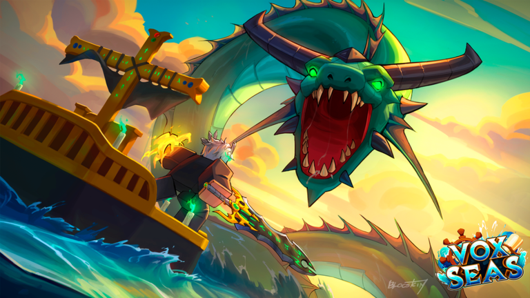

เพิ่งเริ่มเล่นบนเกาะ Solmar? ไปหา Hango ที่ Elder’s House แล้วทำภารกิจเนื้อเรื่อง เมื่อถึงภารกิจ Supplies for the Crossing ให้รับเรือ ค้อนซ่อมเรือ และแผนที่ทีละชิ้นจากร้านด้านหลัง Hale ก่อนออกทะเล

## เลือกคู่มือตามสิ่งที่อยากทำ

- [โค้ด Vox Seas ล่าสุด](/th/codes/) — ดูรางวัลและวิธีแลกโค้ด ก่อนเริ่มฟาร์มด้วยโบนัส XP
- [แผนที่ เกาะ และ NPC](/th/map/) — หาจุดสุ่มผลไม้ ร้านอาวุธ และครูฝึกตามเกาะ
- [สารานุกรมผลไม้](/th/fruits/) — เทียบระดับความหายากและพลังของผลไม้ใน Dawn of Legends
- [อันดับผลไม้](/th/tier-list/) — ดูว่าผลไหนเหมาะกับการฟาร์ม การต่อสู้ หรือการเดินทาง โดยอ้างอิงอันดับจากเวอร์ชัน Legacy
