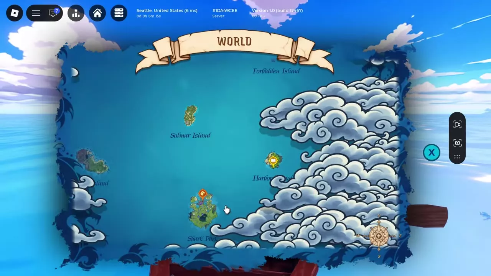

สวมใส่ **Navigator’s Map** แล้วเปิด **WORLD** สัญลักษณ์ **YOU** สีเขียวคือตำแหน่งของคุณ เทียบทิศบนเข็มทิศกับเกาะปลายทางก่อนออกเรือ หากกำลังทำภารกิจเนื้อเรื่อง ให้ตามเครื่องหมายภารกิจด้วย

## เกาะและจุดหมายที่ควรรู้

| จุดหมาย | NPC และสิ่งที่พบ |
| --- | --- |
| Solmar Island | เริ่มเนื้อเรื่องกับ Hango ที่ Elder’s House มีร้านเรือและร้านขาย Slingshot กับ Musket |
| Forbidden Island | ตั้งจุดเกิดที่ค่ายของ Darius ก่อนเดินทางไปบ้านแม่มดของ Morgana หรือต่อสู้กับ Veyrn |
| Circus Town | ร้าน Arms Dealer ขาย Cutlass และ Dual Katana |
| Harbor Island | สุ่มผลไม้ที่ Vox Gacha หา Old Explorer หรือขายปลาที่นี่ |
| Wandering Bastille | เรือร้านอาหารที่ขึ้นได้จากด้านข้าง มี Vox Gacha ภายในร้านและจุดตั้งเกิด |
| Valoria Island | ตามหาเป้าหมายของภารกิจ The Powder Keg บริเวณชายหาดและหน้าผา |
| Golden Dunes | เมืองทะเลทรายที่มีคลองและตลาด Black Market |
| Frost Island | มีหมู่บ้าน ประภาคาร ปราสาทของ Ice King และ Royal Forge |
| Port Island | คู่มือเวอร์ชันเก่าระบุว่ามี Gun Dealer |

## เกาะสำหรับฝึกวิชา

- **Skull Island** — มองหากองไฟบนที่สูงแล้วคุยกับ Askard เพื่อเริ่มฝึก Vox ที่บ่อน้ำกลางเกาะ
- **Rustfall** — คุยกับ Ansel ที่ลานฝึกเพื่อเริ่มบททดสอบ Electro
- **Shark Park** — Nalu อยู่บนชายหาดฝั่งตรงข้ามท่าเรือและสอน Ryusui Ken ส่วน Old Kaito อยู่บนท่าเรือ
- **Heavenstep Mountain** — เปิดธงทั้งเจ็ดจุดระหว่างขึ้นเขา แล้วไปหาครูฝึกบนยอดเขา

หากจุดหมายคือ Vox Gacha ให้ดู [วิธีสุ่มและเลือกผลไม้](/th/fruits/) ก่อนออกเรือ
